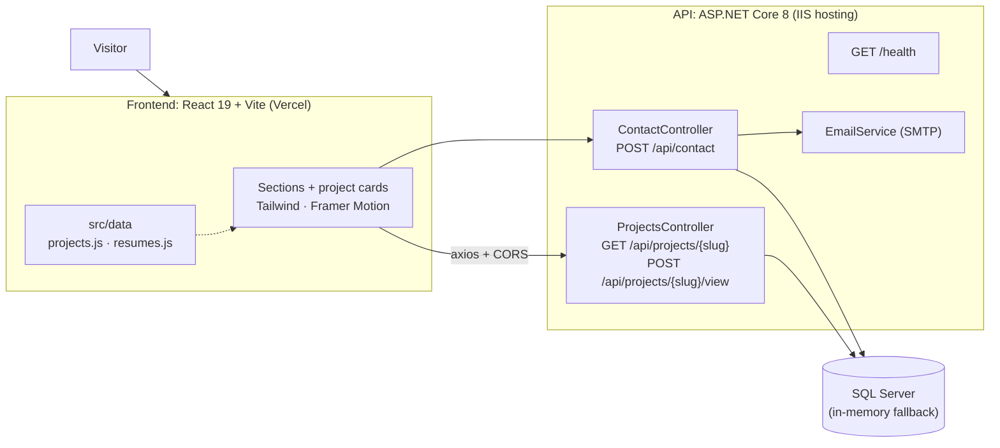

# Zainab Fayyaz: Portfolio

> The source code of my personal portfolio: a React single-page site with a small ASP.NET Core API behind it. It presents my data engineering projects (Kafka, Spark, dbt, Airflow) and my full-stack projects (ASP.NET Core, React, FastAPI), counts project views and stores contact-form messages.

**Live:** https://zainabfayyaz-portfolio.vercel.app


---

## What's on the site

- **Hero, About, Skills, Experience, Projects, Contact** sections with scroll animations (Framer Motion) and a typing intro
- **Projects in two groups:** data engineering and full-stack / machine learning, each with a GitHub link and, where one exists, a live demo
- **Two CVs to download:** a Data Engineering CV and a Full-Stack CV. Their file names are defined in one place (`src/data/resumes.js`)
- **Live view counter** on every project card, backed by the API
- **Contact form** that saves each message to the database and sends an e-mail notification

## Architecture



### Database fallback

The API uses SQL Server when `ConnectionStrings:DefaultConnection` has a value. If it is empty, the API starts with an **in-memory database** (seeded with the project slugs), so the project runs without any setup. `GET /health` reports which one is active:

```json
{ "status": "ok", "db": "sqlserver" }
```

## Tech stack

| Part | Technology |
|---|---|
| Frontend | React 19, Vite 8, Tailwind CSS 3, Framer Motion, Axios, react-type-animation, react-icons, react-hot-toast |
| API | ASP.NET Core 8 Web API, Entity Framework Core (SQL Server and InMemory providers), Swagger |
| Hosting | Vercel (frontend), IIS / MonsterASP (API) |

## Run it locally

**Prerequisites:** Node.js 18+, .NET 8 SDK.

### API
```bash
cd PortfolioAPI/PortfolioAPI
dotnet run
```
With no connection string it uses the in-memory database. For SQL Server, create a git-ignored file `appsettings.Secrets.json` next to `Program.cs` (it is loaded automatically):

```json
{
  "ConnectionStrings": { "DefaultConnection": "<your SQL Server connection string>" },
  "Smtp": { "Host": "smtp.gmail.com", "Port": "587", "User": "", "Password": "", "ToAddress": "" }
}
```

### Frontend
```bash
cd portfolio-frontend
npm install
echo "VITE_API_URL=https://localhost:7131/api" > .env.local   # adjust to your API address
npm run dev
```

### Adding or editing content
- Projects: `portfolio-frontend/src/data/projects.js` (set `category` to `"data"` or `"app"`; omit `liveUrl` to hide the Live button)
- CVs: replace the two PDFs in `portfolio-frontend/public/`; the names are listed in `src/data/resumes.js`
- New project slugs get their own view counter automatically the first time they are viewed

## Project structure

```text
.
├── PortfolioAPI/PortfolioAPI/
│   ├── Controllers/     Projects (views) and Contact
│   ├── Services/        EmailService
│   ├── Models/ DTOs/    ProjectView, ContactMessage, ContactDto
│   ├── Data/            AppDbContext
│   └── Program.cs       DI, CORS, database selection, /health
└── portfolio-frontend/
    ├── public/          CV PDFs, favicon, preview image
    └── src/
        ├── components/  Hero, About, Skills, Experience, Projects, ProjectCard, Contact ...
        ├── data/        projects.js, resumes.js
        └── api/         Axios client
```

## Security notes

- Secrets are never committed: `appsettings.Secrets.json`, publish profiles (`*.user`) and build output (`publish_output/`) are git-ignored.
- The API allows requests only from the local dev server and the deployed frontend origin (CORS).

## Author

**Zainab Fayyaz**: [LinkedIn](https://www.linkedin.com/in/zainab-fayyaz-4a2958386) · [GitHub](https://github.com/zainab-f207) · zainabfayyaz207@gmail.com
